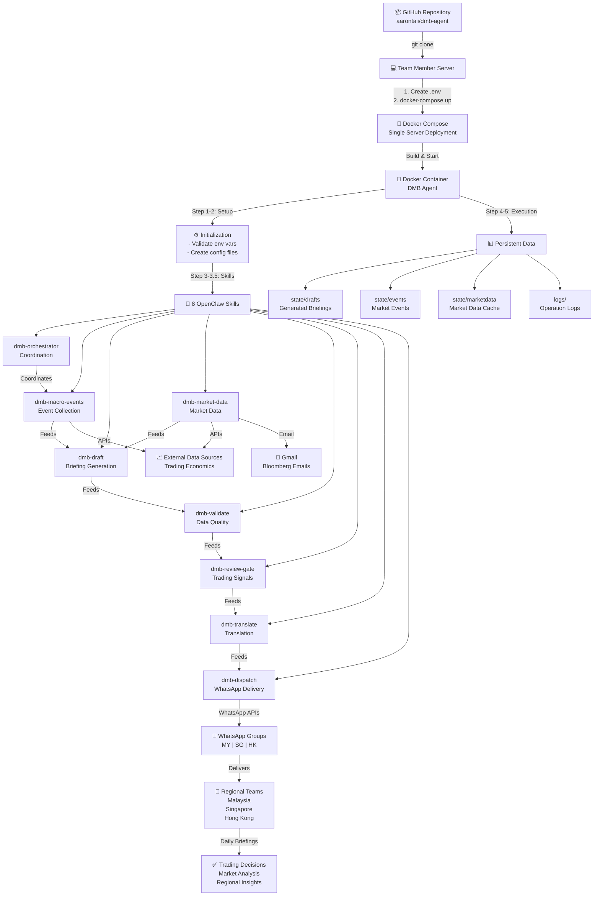
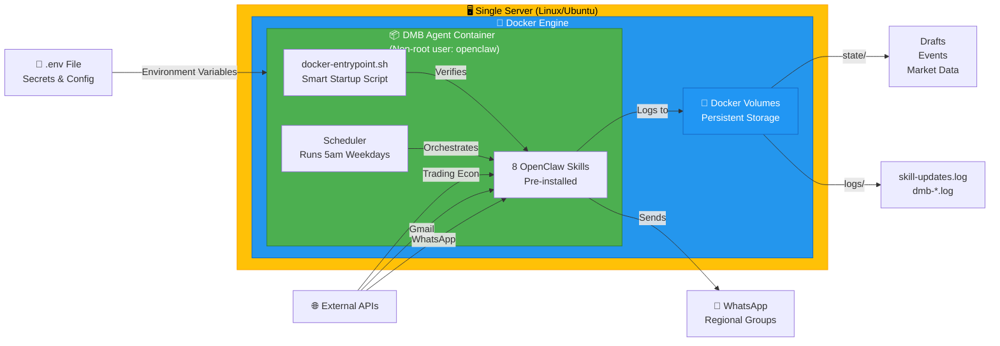
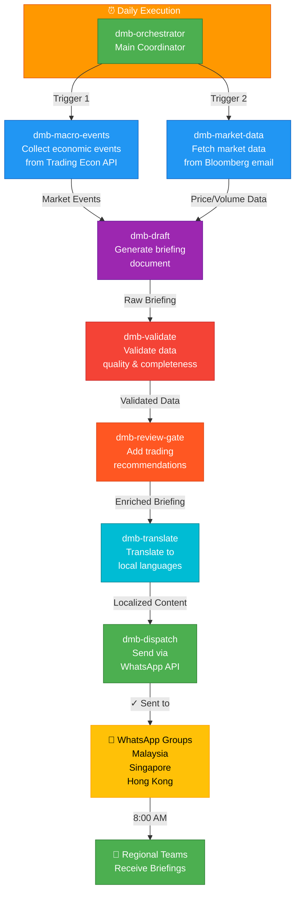
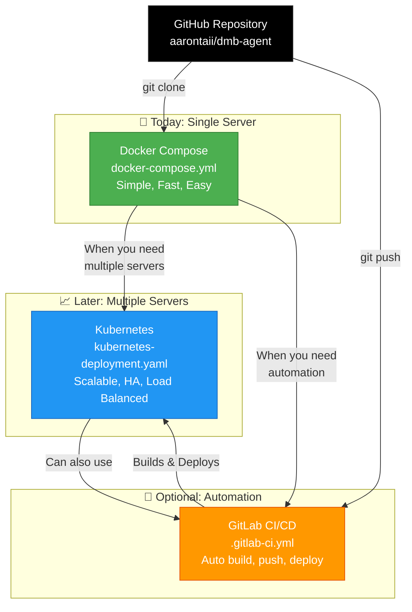
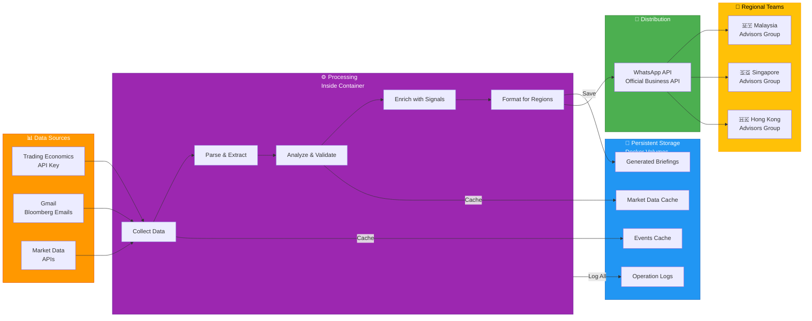
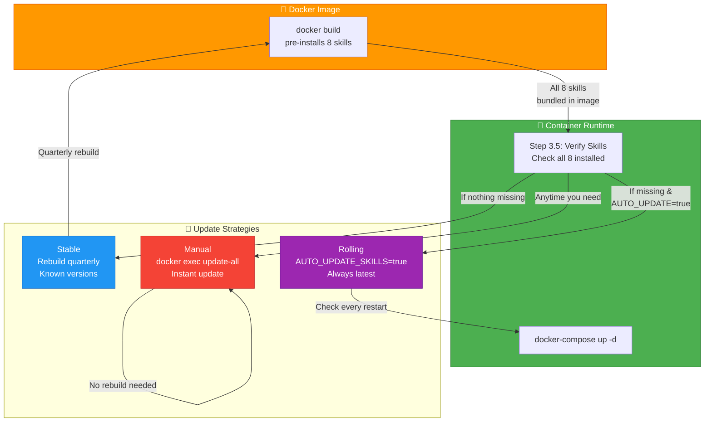
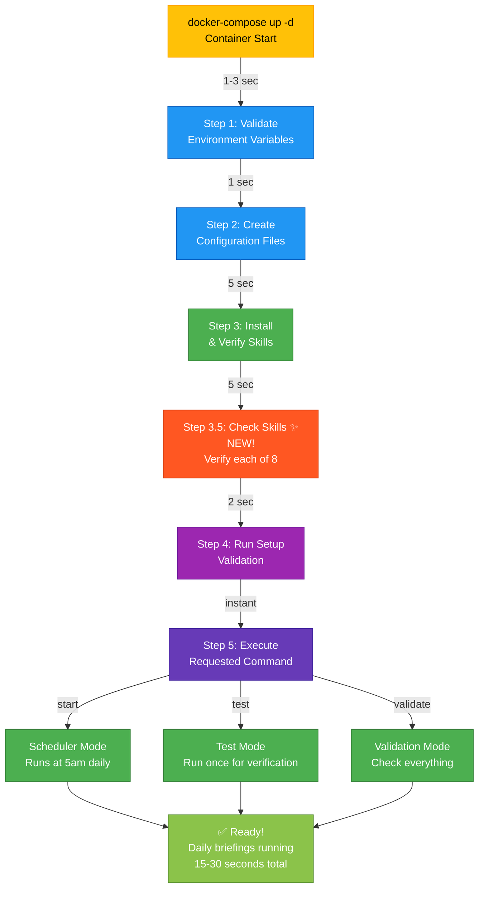
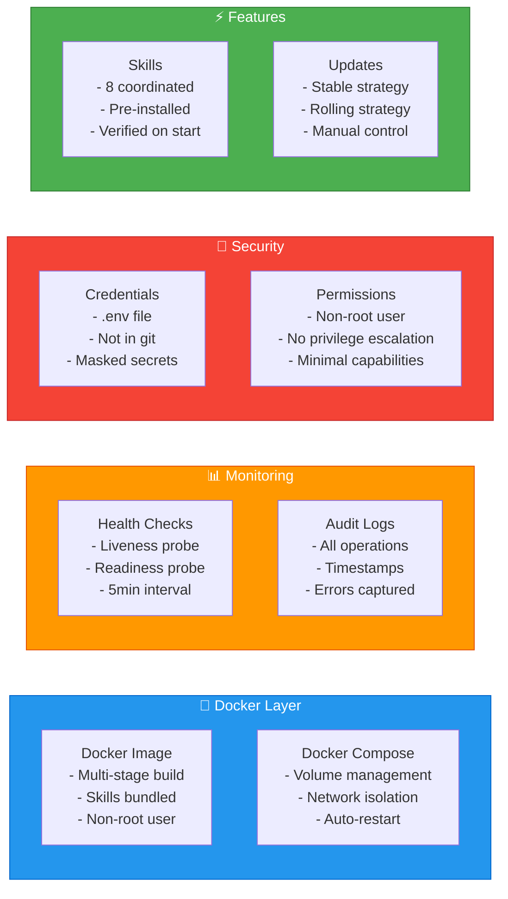

# DMB Agent - Deployment Architecture Diagrams

**Visual diagrams showing how the DMB Agent deployment works end-to-end.**

---

## 📊 Complete Deployment Flow

Shows the entire system from GitHub repository to regional teams receiving daily briefings.

---

## 🖥️ Single Server Architecture (Docker Compose)

Shows what runs on a single server using Docker Compose.

---

## ⏰ Daily Skill Pipeline Execution

Shows what happens each day at 5:00 AM when the orchestrator triggers all skills.

---

## 📈 Deployment Options & Growth Path

Shows how you can scale from single server to Kubernetes and add CI/CD automation.

---

## 🔄 Data Flow: Sources to Teams

Shows how data flows from external sources through processing to regional teams.

---

## 🔧 Skill Management Strategy

Shows how skills are managed: from build-time bundling to three update strategies.

---

## 🚀 Container Startup Sequence

Shows what happens when you run `docker-compose up -d` - 5 steps to production ready.

---

## 🛡️ Production Ready Components

Shows all production-ready aspects: Docker, Monitoring, Security, and Features.

---

## 📖 Using These Diagrams

### For Team Onboarding
- Show Diagram 1 (Complete Flow) for overview
- Show Diagram 2 (Single Server) for architecture
- Show Diagram 3 (Skill Pipeline) for workflow

### For Documentation
- Add to README.md
- Reference in setup guides
- Include in technical specifications

### For Presentations
- Executive overview: Diagram 1
- Technical deep-dive: Diagrams 2-3
- Growth strategy: Diagram 4

### For Troubleshooting
- Reference Diagram 7 (Startup) when container issues
- Reference Diagram 5 (Data Flow) for data issues
- Reference Diagram 8 (Components) for architecture questions

---

## 🔗 Diagram Files

All diagrams are created using **Mermaid**, which is:
- ✅ Supported by GitHub (auto-rendered in README)
- ✅ Editable text format (in markdown)
- ✅ Version controllable (in git)
- ✅ Easy to update

To use in your own files:
1. Copy the mermaid code block
2. Paste into any `.md` file
3. GitHub auto-renders
4. Update anytime by editing markdown

---

**Version:** 1.0 | **Created:** 2026-07-31 | **Format:** Mermaid
